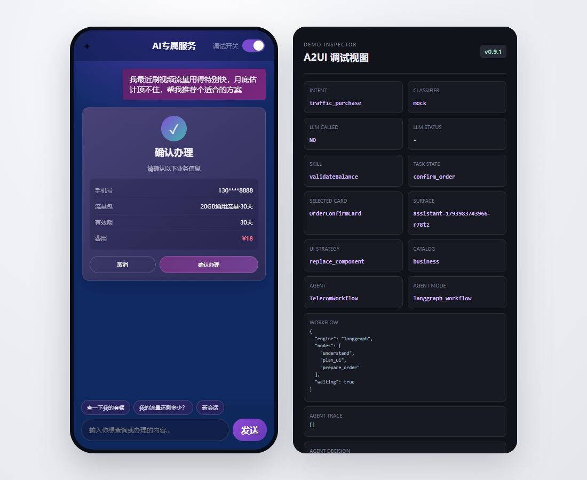
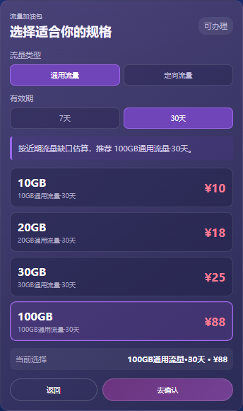
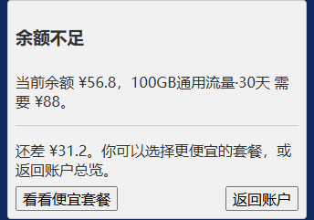
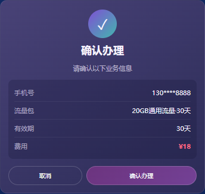

<div align="center">

# A2UI Telecom Service
### 从一句需求，到可操作的业务界面

查询流量、比较套餐、处理余额不足，再确认办理。<br>
通过 A2UI 将 Agent 的业务结果呈现为可继续操作的卡片。

**React · A2UI · LangGraph · DeepSeek · SQLite**

[界面演示](#界面演示) · [快速开始](#快速开始) · [工作原理](#工作原理) · [文档](#文档)

</div>



*本地运行截图：左侧为待确认订单，右侧展示任务状态与 A2UI 界面策略。使用模拟业务数据与规则模式。*

## 界面演示

> “我最近刷视频流量用得特别快，月底估计顶不住，帮我推荐个适合的方案。”

从套餐推荐出发，用户可以在卡片中继续完成选择与确认；余额不足时，界面给出恢复入口。

<table>
  <tr>
    <th width="33%">① 选择套餐</th>
    <th width="33%">② 余额不足，重新选择</th>
    <th width="33%">③ 核对并确认办理</th>
  </tr>
  <tr>
    <td valign="top"></td>
    <td valign="top"></td>
    <td valign="top"></td>
  </tr>
</table>

演示账户余额为 ¥56.8，选择 ¥88 套餐会触发余额不足；改选 ¥18 套餐后可以继续确认。较小套餐体现价格取舍，并不覆盖原先的全部流量缺口。所有办理仅更新本地模拟账户。

## 项目特点

- **界面随任务变化**：推荐、余额不足、订单确认分别展示对应的卡片或组件组合。
- **在卡片中继续办理**：筛选、选择和确认通过 A2UI Action 回传服务端，推动当前任务。
- **业务组件与基础组件组合**：高频场景使用固定业务卡片，余额不足使用 Basic Catalog 组合提示与按钮。
- **可恢复、可观察**：刷新或重启后恢复进度；调试面板展示工具调用、任务状态和界面消息。

还可以体验账户总览、流量详情、账单查询与业务图表。输入“查一下我的套餐”或“看看最近业务情况”即可开始。

## 快速开始

需要 **Node.js 24.13 或更新的 24.x 版本**。

```bash
git clone --branch fix/review-package-selection https://github.com/geomini1989-cpu/a2ui-telecom-service-demo.git
cd a2ui-telecom-service-demo
npm ci
npm run dev
```

打开 [http://localhost:5173](http://localhost:5173) 即可体验，默认无需模型密钥。接入 DeepSeek 或兼容模型服务见 [配置指南](docs/configuration.md)。

## 工作原理


A2UI 负责描述界面、绑定数据与回传操作，React Catalog 负责组件实现，LangGraph 和 SQLite 负责流程与状态恢复。模型可以查询和推荐；模拟订单必须经过用户明确确认与服务端校验。

这是 **A2UI 在电信业务中的交互示例**，当前实现面向 React Web。更详细的职责与接口见 [架构说明](docs/architecture.md) 和 [开发指南](docs/development.md)。

## 文档

| 文档 | 内容 |
|---|---|
| [配置指南](docs/configuration.md) | 模型接入、端口与持久化设置 |
| [演示脚本](docs/demo-script.md) | 完整业务流程与讲解顺序 |
| [架构说明](docs/architecture.md) | Agent、UI Policy、Catalog 与业务校验 |
| [开发与验证](docs/development.md) | 状态恢复、接口、测试命令与截图说明 |

## 当前边界

- 使用内置模拟数据，尚未连接真实运营商的计费与订单系统。
- 持久化与订单保护面向本地单实例演示；公网部署还需补充认证与会话归属校验。
- 规则演示和自动化测试不代表真实模型效果；模型能力需单独评估。