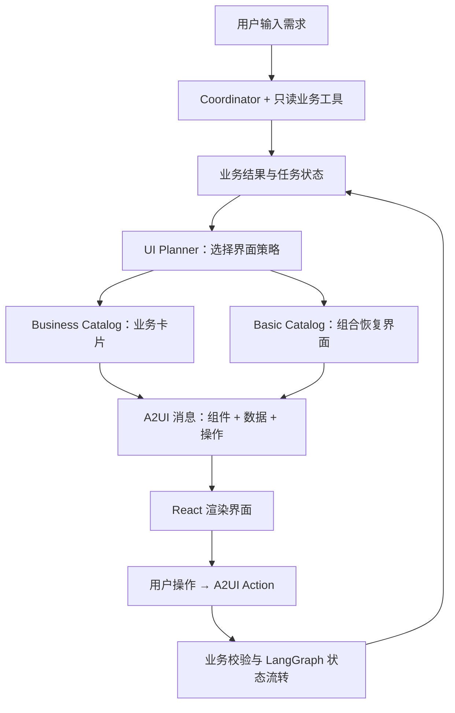

<div align="center">

# A2UI Telecom Service
### 可交互的电信服务 Agent

**说出需求，在卡片里完成选择、调整与确认。**

从查询流量、推荐套餐，到余额不足时重新选择、确认办理，<br>
让 Agent 的业务结果变成可以继续操作的界面。

**A2UI · React · LangGraph · DeepSeek Tool Calling · SQLite**

[体验场景](#体验场景) · [快速开始](#快速开始) · [A2UI 如何工作](#a2ui-如何工作) · [测试与验证](#测试与验证) · [开发文档](#开发文档)

</div>

---

## 核心功能

| | 你可以体验什么 |
|---|---|
| **对话进入业务流程** | 用自然语言查询账户、流量和账单，或根据使用情况获取套餐推荐 |
| **在卡片里继续操作** | 比较套餐、切换筛选条件、选择套餐，再核对并确认办理 |
| **异常后继续完成任务** | 余额不足时展示差额和可用操作，重新筛选可支付的套餐 |
| **查看过程并恢复进度** | 在调试面板查看 Agent 与 A2UI 消息；刷新页面或重启服务后恢复当前界面 |

项目使用内置模拟业务数据，办理只更新本地 SQLite 中的余额和订单，不连接真实运营商系统。**无需模型密钥即可运行规则演示；配置模型后可体验只读工具调用。**

## 体验场景

### 从“流量不够”到“确认办理”

启动后，可以从这句话开始：

> 我最近刷视频流量用得特别快，月底估计顶不住，帮我推荐个适合的方案。

下面是基于仓库内置数据的演示流程。真实模型的推荐可能不同，可在 Debug Inspector 中查看本次执行过程。

| 步骤 | 页面呈现 | 你的操作 |
|---|---|---|
| **1. 查看推荐** | 套餐卡片展示候选及推荐理由 | 比较并选择套餐，点击“去确认” |
| **2. 处理余额不足** | 显示账户余额、套餐价格、差额与恢复入口 | 点击“看看便宜套餐” |
| **3. 重新选择** | 回到套餐卡片，筛选当前余额可支付的候选 | 改选合适的套餐 |
| **4. 核对订单** | 确认卡片展示即将办理的套餐和费用 | 点击“确认办理”，或取消 |
| **5. 查看结果** | 结果卡片展示本地订单回执 | 查看办理结果与更新后的账户 |

新会话初始余额为 **¥56.8**。选择 **100GB / 30 天 / ¥88** 套餐可触发余额不足流程；改选 **20GB / 30 天 / ¥18** 套餐可继续确认。这里的改选展示价格取舍，并不代表较小套餐能够覆盖原先的全部流量缺口。

### 其他入口

| 请求 | 展示内容 |
|---|---|
| “查一下我的套餐” | 账户余额、套餐及用量总览 |
| “我的流量还剩多少？” | 流量使用详情 |
| “查一下我的账单” | 月度账单及费用明细 |
| “看看最近业务情况” | 业务分析图表，可切换近 7 天、近 30 天和近半年 |

演示时可以切换分析卡片的时间范围，观察同一界面如何通过 `updateDataModel` 更新数据。完整讲解顺序见 [演示脚本](docs/demo-script.md)。

## 快速开始

### 1. 获取项目

需要 **Node.js 24.13 或更新的 24.x 版本**，项目使用内置 `node:sqlite`。

```bash
git clone --branch fix/review-package-selection https://github.com/geomini1989-cpu/a2ui-telecom-service-demo.git
cd a2ui-telecom-service-demo
npm ci
npm run dev
```

> 当前功能位于 `fix/review-package-selection` 分支；默认 `main` 与该分支内容不同。

打开 [http://localhost:5173](http://localhost:5173)。开发命令会同时启动 React / Vite 前端和位于 `http://localhost:8787` 的 Express 服务。

不配置模型即可开始演示，此时调试面板显示 `deterministic_fallback`，自然语言理解由本地规则完成。

### 2. 可选：接入 DeepSeek 或兼容模型服务

将根目录的 [.env.example](.env.example) 复制为 `.env`，填写：

```dotenv
LLM_MODE=openai-compatible
LLM_BASE_URL=https://api.deepseek.com
LLM_API_KEY=替换为模型服务密钥
LLM_MODEL=替换为该服务支持工具调用的模型名称
PORT=8787
```

重启开发服务。模型正常执行工具调用时，Debug Inspector 的 `Agent Mode` 显示为 `llm_tool_calling`；未配置或调用失败时会进入规则兜底。模型名称、密钥与服务地址需匹配。

<details>
<summary><b>启动与持久化配置</b></summary>

- **Node 版本**：请用 `node --version` 检查是否满足 `>=24.13.0 <25`。
- **数据目录**：默认写入 `.data`，可用 `TELECOM_DATA_DIR` 修改；保留目录即可在服务重启后恢复会话。
- **新会话**：页面“新会话”按钮创建独立会话及账户状态，旧会话仍保留。
- **自定义端口**：后端通过 `PORT` 设置；前端开发代理默认指向 `http://localhost:8787`，更改后端端口时需为 Vite 进程设置对应的 `TELECOM_API_URL`。

</details>

## A2UI 如何工作

在这个项目中，**A2UI 将业务状态表达为组件、数据绑定与操作，再由前端渲染成用户可以继续使用的界面**。

套餐推荐时显示选择卡片，余额不足时组合恢复界面，准备办理时显示确认卡片。卡片上的操作通过 Action 回传服务端，推动同一个任务进入下一状态。



### 两类 Catalog，各自解决什么问题

| 场景 | 采用方式 | 本项目中的例子 |
|---|---|---|
| 稳定、高频的业务界面 | Business Catalog：预先开发并注册 React 组件 | 账户、套餐选择、订单确认、账单和分析图表 |
| 异常恢复与组合界面 | Basic Catalog：组合受控的基础组件 | 余额不足时组合提示、金额、分隔线与操作按钮 |

余额不足界面由 `Card / Column / Text / Divider / Row / Button` 组合而成。页面结构稳定时可只更新数据模型；任务状态变化时，再更新组件结构。

模型负责理解需求和查询建议，UI Planner 负责选择界面，React Catalog 负责视觉与组件实现。A2UI 在这些层之间传递界面描述和交互，LangGraph 与 SQLite 则负责流程暂停、恢复及状态保存。

### 如何观察这条链路

桌面宽度下，右侧 Debug Inspector 可以查看：

| 调试信息 | 用来确认什么 |
|---|---|
| `Agent Mode`、`Agent Trace` | 本次使用模型还是规则，调用了哪些只读工具 |
| `Task State`、`Agent Decision` | 当前任务进展与业务判断 |
| `Selected Card`、`Catalog`、`UI Strategy` | 为什么展示这类界面 |
| A2UI Messages | `createSurface`、`updateComponents`、`updateDataModel` 如何更新页面 |

例如，余额不足时可以观察 Catalog 从业务卡片切换为基础组件组合；分析图表切换时间范围时，可以观察数据模型更新。

## 用户确认与流程恢复

**模型可以查询和推荐，办理必须经过用户明确确认与服务端校验。**

`executeOrder` 不对模型开放。只有流程已进入确认状态，并且用户点击“确认办理”或输入精确文本“确认办理”，服务端才会继续执行本地订单；推荐和余额预检查本身不会办理。

| 机制 | 对用户操作的影响 |
|---|---|
| 确认前重新检查余额与套餐 | 条件变化时要求恢复或重新选择 |
| 会话版本与待办订单校验 | 旧卡片或不匹配的提交会被拒绝，前端恢复最新状态 |
| 本地订单幂等与事务 | 同一订单重复确认返回原回执，避免重复本地扣费 |
| 流程检查点与界面持久化 | 刷新页面或重启服务后可继续待确认任务 |
| 筛选与推荐同步 | 改变筛选条件会清除旧选择；需求变化后不继续沿用不匹配的推荐 |

<details>
<summary><b>工具、状态与持久化细节</b></summary>

模型可调用的只读工具包括 `getAccountInfo`、`getTrafficUsage`、`getTrafficPackages`、`getBill`、`getBusinessMetrics` 和 `validateBalance`。

外层业务流程使用 LangGraph `StateGraph`，确认节点通过 `interrupt` 暂停，用户确认或取消后通过 `Command` 恢复。SQLite 保存会话、余额账本、订单快照、回执、当前 A2UI Surface 与检查点。

```text
select_package        → 套餐选择卡片
insufficient_balance  → Basic Catalog 恢复界面
confirm_order         → 订单确认卡片
completed             → 办理结果卡片
```

本地扣费、回执与会话更新在同一事务中完成。单个服务实例按会话串行处理请求，当前不提供多实例工作流调度，也不保证真实运营商交易的“恰好一次”执行。

传输采用 NDJSON，承载 A2UI 与执行结果消息，不是模型 token 流。

</details>

## 测试与验证

```bash
npm run verify
```

该命令依次执行类型检查、Vitest 测试、生产构建与 Playwright 浏览器测试。也可以分别运行 `npm run typecheck`、`npm test`、`npm run build` 和 `npm run test:e2e`。

| 验证层级 | 覆盖场景 |
|---|---|
| [服务端集成测试](server/workflow.test.ts) | LangGraph 与 SQLite 的重启恢复、重复确认、过期或跨会话提交、余额与套餐变化、工具调用边界及模型失败兜底 |
| [浏览器测试](e2e/telecom.spec.ts) | 页面刷新恢复、余额不足后重选、跨标签页冲突、改变筛选条件后清除旧选择 |
| 类型检查与构建 | TypeScript 检查、React / Vite 生产构建 |

模型调用测试使用协议夹具，不能作为真实模型效果成绩。

<details>
<summary><b>浏览器测试环境</b></summary>

本地 Playwright 默认使用 **Microsoft Edge**；CI 使用已安装的 Playwright Chromium。测试服务使用独立端口 `5178 / 8790` 和 `.data/e2e` 数据目录。

仅安装 Playwright Chromium 不会改变本地默认的 `msedge` 通道；在没有 Edge 的环境中运行前，需要调整 [Playwright 配置](playwright.config.ts) 的浏览器通道。

</details>

## 当前边界

- 账户、流量、账单与套餐来自仓库内置数据；尚未接入运营商 BSS、CRM、计费或订单系统。
- 当前未提供生产级认证与会话归属校验，持有会话标识即可访问对应会话；公网部署前需要补齐访问控制。
- 持久化与订单保护面向本地单实例演示，尚未覆盖多实例调度、完整审计、监控和协议协商。
- 规则模式用于复现业务交互；真实模型的理解与工具选择效果需要另行评估。

## 开发文档

- [架构说明](docs/architecture.md)：Agent、Skill、UI Policy、A2UI 与业务校验的职责。
- [演示脚本](docs/demo-script.md)：推荐、余额不足、恢复与办理的完整讲解顺序。
- [环境变量示例](.env.example)：模型服务、端口与持久化目录配置。

<details>
<summary><b>代码导航与 API</b></summary>

| 入口 | 职责 |
|---|---|
| [前端 Catalog](src/a2ui/catalog.tsx) | 业务组件、数据绑定与交互 |
| [应用与调试面板](src/App.tsx) | 聊天、消息处理和 Debug Inspector |
| [Coordinator](server/agent/coordinator.ts) | 只读工具调用循环 |
| [UI Planner](server/planner.ts) | 业务结果与任务状态映射为界面策略 |
| [业务卡片 Builder](server/a2ui-builder.ts) / [基础组件 Builder](server/basic-builder.ts) | 生成 A2UI 消息 |
| [LangGraph 工作流](server/workflow.ts) | 节点执行、确认暂停与恢复 |
| [数据库](server/database.ts) | 会话、订单及余额事务 |

| 接口 | 用途 |
|---|---|
| `GET /api/health` | 健康检查 |
| `GET /api/session/:id` | 恢复会话与当前界面 |
| `POST /api/chat/stream` | 接收 `sessionId`、`message`、`expectedVersion` |
| `POST /api/action/stream` | 接收 `sessionId` 与卡片 `action` |

Action 的 `context.sessionVersion` 和确认时的 `context.pendingOrderId` 由服务端写入界面消息。版本冲突返回 `409`，前端重新读取当前状态。

</details>
