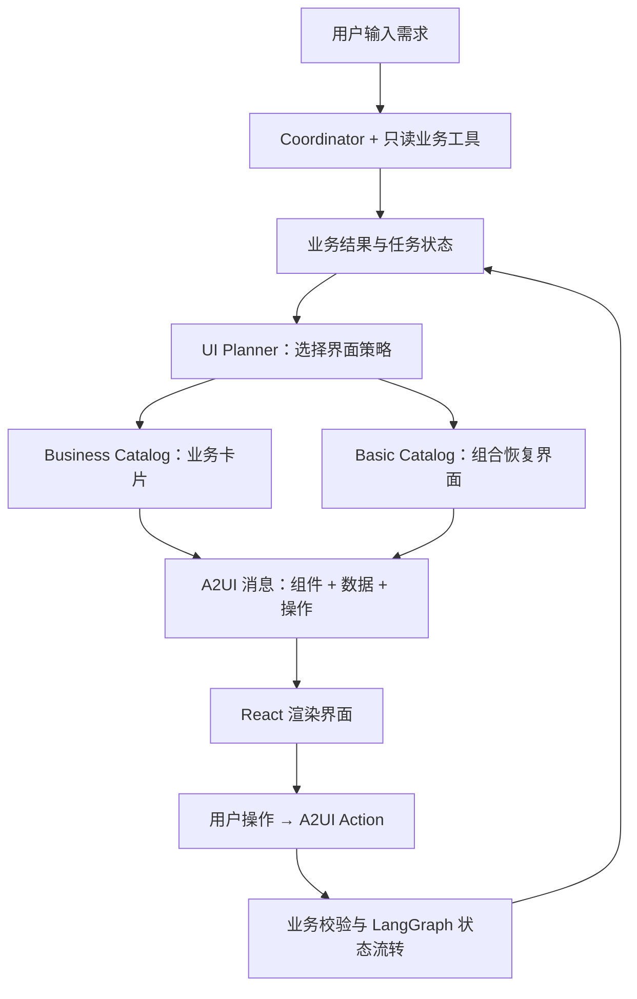
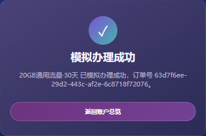

# 开发与验证

[返回项目首页](../README.md) · [配置指南](configuration.md)

## A2UI 如何工作

在这个项目中，**A2UI 将业务状态表达为组件、数据绑定与操作，再由前端渲染成用户可以继续使用的界面**。

套餐推荐时显示选择卡片，余额不足时组合恢复界面，准备办理时显示确认卡片。卡片上的操作通过 Action 回传服务端，推动同一个任务进入下一状态。



### 两类 Catalog，各自解决什么问题

| 场景 | 采用方式 | 本项目中的例子 |
|---|---|---|
| 稳定、高频的业务界面 | Business Catalog：预先开发并注册 React 组件 | 账户、套餐选择、订单确认、账单和分析图表 |
| 异常恢复与组合界面 | Basic Catalog：组合受控的基础组件 | 余额不足时组合提示、金额、分隔线与操作按钮 |

余额不足界面由 `Card / Column / Text / Divider / Row / Button` 组合而成。页面结构稳定时可只更新数据模型；任务状态变化时，再更新组件结构。

模型负责理解需求和查询建议，UI Planner 负责选择界面，React Catalog 负责视觉与组件实现。A2UI 在这些层之间传递界面描述和交互，LangGraph 与 SQLite 则负责流程暂停、恢复及状态保存。

### 如何观察这条链路

桌面宽度下，右侧 Debug Inspector 可以查看：

| 调试信息 | 用来确认什么 |
|---|---|
| `Agent Mode`、`Agent Trace` | 本次使用模型还是规则，调用了哪些只读工具 |
| `Task State`、`Agent Decision` | 当前任务进展与业务判断 |
| `Selected Card`、`Catalog`、`UI Strategy` | 为什么展示这类界面 |
| A2UI Messages | `createSurface`、`updateComponents`、`updateDataModel` 如何更新页面 |

例如，余额不足时可以观察 Catalog 从业务卡片切换为基础组件组合；分析图表切换时间范围时，可以观察数据模型更新。

## 用户确认与流程恢复

**模型可以查询和推荐，办理必须经过用户明确确认与服务端校验。**

`executeOrder` 不对模型开放。只有流程已进入确认状态，并且用户点击“确认办理”或输入精确文本“确认办理”，服务端才会继续执行本地订单；推荐和余额预检查本身不会办理。

| 机制 | 对用户操作的影响 |
|---|---|
| 确认前重新检查余额与套餐 | 条件变化时要求恢复或重新选择 |
| 会话版本与待办订单校验 | 旧卡片或不匹配的提交会被拒绝，前端恢复最新状态 |
| 本地订单幂等与事务 | 同一订单重复确认返回原回执，避免重复本地扣费 |
| 流程检查点与界面持久化 | 刷新页面或重启服务后可继续待确认任务 |
| 筛选与推荐同步 | 改变筛选条件会清除旧选择；需求变化后不继续沿用不匹配的推荐 |

<details>
<summary><b>工具、状态与持久化细节</b></summary>

模型可调用的只读工具包括 `getAccountInfo`、`getTrafficUsage`、`getTrafficPackages`、`getBill`、`getBusinessMetrics` 和 `validateBalance`。

外层业务流程使用 LangGraph `StateGraph`，确认节点通过 `interrupt` 暂停，用户确认或取消后通过 `Command` 恢复。SQLite 保存会话、余额账本、订单快照、回执、当前 A2UI Surface 与检查点。

```text
select_package        → 套餐选择卡片
insufficient_balance  → Basic Catalog 恢复界面
confirm_order         → 订单确认卡片
completed             → 办理结果卡片
```

本地扣费、回执与会话更新在同一事务中完成。单个服务实例按会话串行处理请求，当前不提供多实例工作流调度，也不保证真实运营商交易的“恰好一次”执行。

传输采用 NDJSON，承载 A2UI 与执行结果消息，不是模型 token 流。

</details>

## 测试与验证

```bash
npm run verify
```

该命令依次执行类型检查、Vitest 测试、生产构建与 Playwright 浏览器测试。也可以分别运行 `npm run typecheck`、`npm test`、`npm run build` 和 `npm run test:e2e`。

| 验证层级 | 覆盖场景 |
|---|---|
| [服务端集成测试](../server/workflow.test.ts) | LangGraph 与 SQLite 的重启恢复、重复确认、过期或跨会话提交、余额与套餐变化、工具调用边界及模型失败兜底 |
| [浏览器测试](../e2e/telecom.spec.ts) | 页面刷新恢复、余额不足后重选、跨标签页冲突、改变筛选条件后清除旧选择 |
| 类型检查与构建 | TypeScript 检查、React / Vite 生产构建 |

模型调用测试使用协议夹具，不能作为真实模型效果成绩。

<details>
<summary><b>浏览器测试环境</b></summary>

本地 Playwright 默认使用 **Microsoft Edge**；CI 使用已安装的 Playwright Chromium。测试服务使用独立端口 `5178 / 8790` 和 `.data/e2e` 数据目录。

仅安装 Playwright Chromium 不会改变本地默认的 `msedge` 通道；在没有 Edge 的环境中运行前，需要调整 [Playwright 配置](../playwright.config.ts) 的浏览器通道。

</details>


<details>
<summary><b>代码导航与 API</b></summary>

| 入口 | 职责 |
|---|---|
| [前端 Catalog](../src/a2ui/catalog.tsx) | 业务组件、数据绑定与交互 |
| [应用与调试面板](../src/App.tsx) | 聊天、消息处理和 Debug Inspector |
| [Coordinator](../server/agent/coordinator.ts) | 只读工具调用循环 |
| [UI Planner](../server/planner.ts) | 业务结果与任务状态映射为界面策略 |
| [业务卡片 Builder](../server/a2ui-builder.ts) / [基础组件 Builder](../server/basic-builder.ts) | 生成 A2UI 消息 |
| [LangGraph 工作流](../server/workflow.ts) | 节点执行、确认暂停与恢复 |
| [数据库](../server/database.ts) | 会话、订单及余额事务 |

| 接口 | 用途 |
|---|---|
| `GET /api/health` | 健康检查 |
| `GET /api/session/:id` | 恢复会话与当前界面 |
| `POST /api/chat/stream` | 接收 `sessionId`、`message`、`expectedVersion` |
| `POST /api/action/stream` | 接收 `sessionId` 与卡片 `action` |

Action 的 `context.sessionVersion` 和确认时的 `context.pendingOrderId` 由服务端写入界面消息。版本冲突返回 `409`，前端重新读取当前状态。

</details>


## 演示素材

首页图片来自本项目的本地规则模式（`LLM_MODE=mock`），使用独立演示数据库和全新会话。金额、手机号与订单均为模拟数据，不代表真实运营商业务或模型效果。

截图步骤：提出流量推荐需求 → 选择 100GB / 30 天 / ¥88 → 余额不足 → 查看便宜套餐 → 改选 20GB / 30 天 / ¥18 → 确认页刷新恢复 → 确认办理。



截图过程验证了确认页刷新恢复、模拟订单完成，并检查浏览器无页面脚本错误。